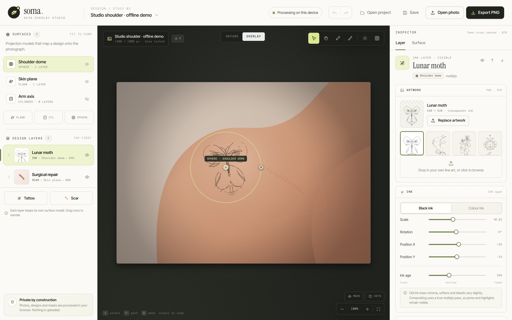

# web-apps

A collection of browser-based web applications by actofangel.
Each app lives in its own folder under `apps/` and runs directly in the browser, with no installation or build step.

## Apps

| App | Description | Demo |
| --- | --- | --- |
| [**Soma — Skin Overlay Studio**](apps/soma-skin-overlay-studio/) | A local-first studio for previewing tattoos and procedural scars on your own photograph, wrapped to the curves of the body | [Open](https://actofangel.github.io/web-apps/apps/soma-skin-overlay-studio/) |

[](apps/soma-skin-overlay-studio/)

## Structure

```
web-apps/
├── README.md
└── apps/
    └── <app-name>/
        ├── index.html   … the app
        └── README.md    … app-specific notes
```

To add a new app, create `apps/<app-name>/` and add a row to the table above.

## License

[MIT License](LICENSE) © 2026 actofangel
