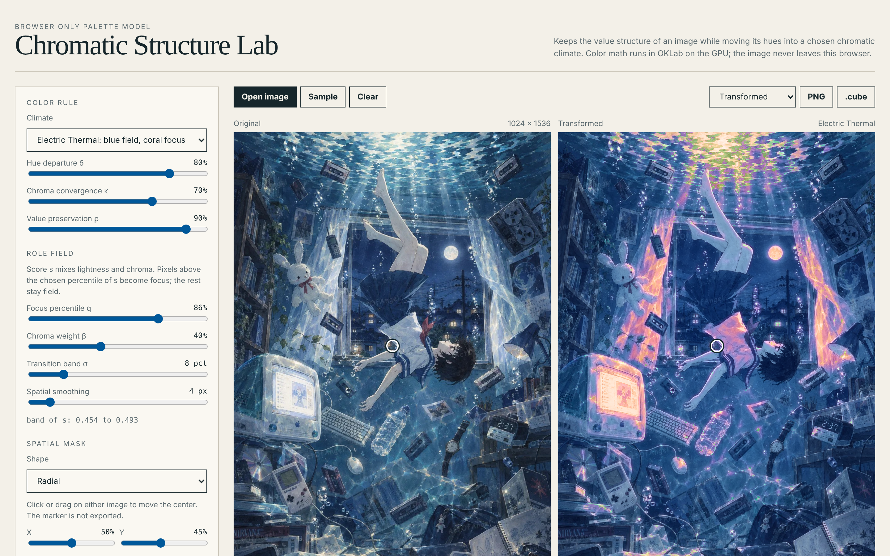
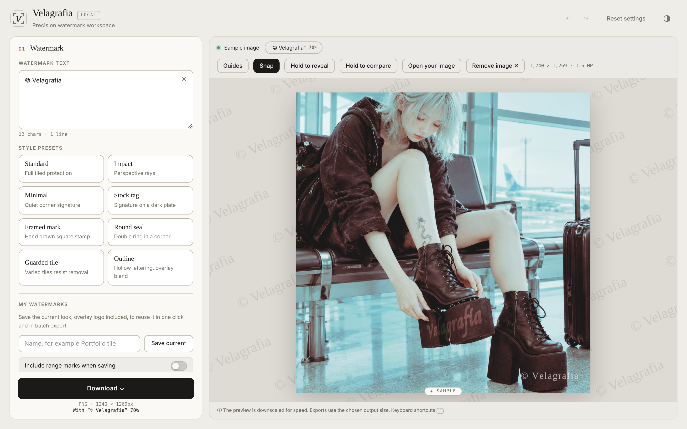
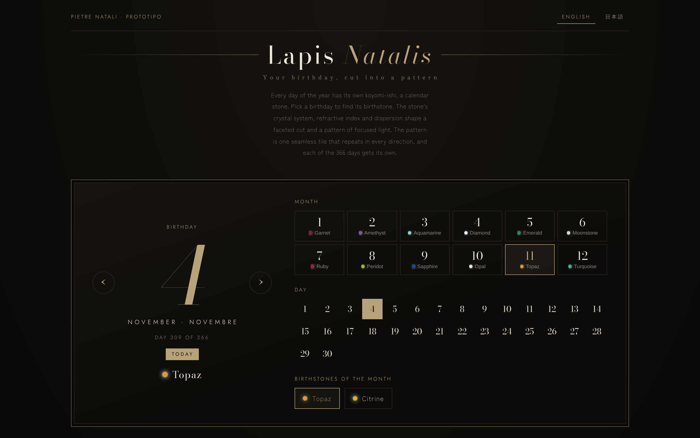
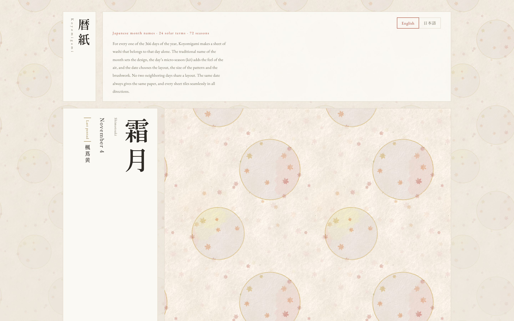
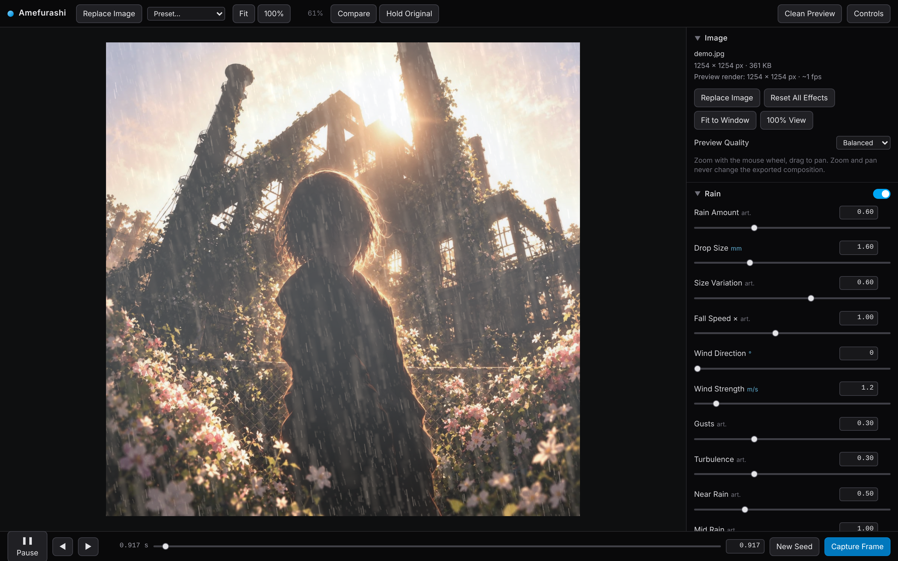
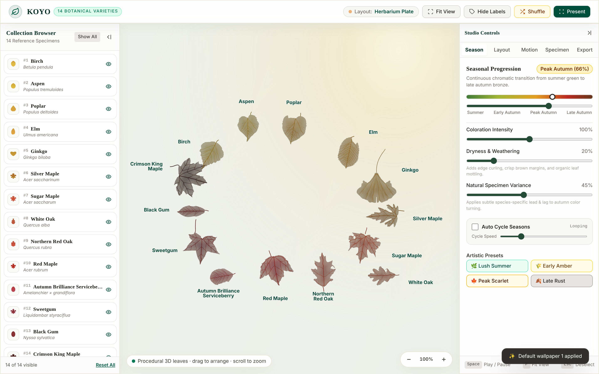

# web-apps

A collection of browser-based web applications by actofangel.
Each app lives in its own folder under `apps/` and runs directly in the browser, with no installation or build step.

## Apps

### Image tools

Apps that edit, transform or protect your own images.

| App | Description | Demo |
| --- | --- | --- |
| [**Soma — Skin Overlay Studio**](apps/soma-skin-overlay-studio/) | A local-first studio for previewing tattoos and procedural scars on your own photograph, wrapped to the curves of the body | [Open](https://actofangel.github.io/web-apps/apps/soma-skin-overlay-studio/) |
| [**Chromatic Structure Lab**](apps/chromatic-structure-lab/) | Keeps the value structure of an image while moving its hues into a chosen chromatic climate, with OKLab color math on the GPU and PNG / `.cube` LUT export | [Open](https://actofangel.github.io/web-apps/apps/chromatic-structure-lab/) |
| [**Velagrafia**](apps/velagrafia/) | A precision watermark workspace with tiled, stamp and seal layouts, logo overlays, rights metadata and batch export | [Open](https://actofangel.github.io/web-apps/apps/velagrafia/) |
| [**Amefurashi**](apps/amefurashi/) | Turns a photograph into a rainy scene with rain in depth, mist, wet reflections, splashes and rain on glass, exported as PNG stills or WebM video | [Open](https://actofangel.github.io/web-apps/apps/amefurashi/) |

### Generators

Apps that create new material, such as patterns, tiles and wallpapers.

| App | Description | Demo |
| --- | --- | --- |
| [**Lapis Natalis**](apps/lapis-natalis/) | Turns a birthday into its birthstone, a faceted cut and a seamless caustic pattern, unique to each of the 366 days | [Open](https://actofangel.github.io/web-apps/apps/lapis-natalis/) |
| [**Koyomigami**](apps/koyomigami/) | Forms a sheet of washi for each day of the year from the Japanese month names, 24 solar terms and 72 seasons, using a physical papermaking model | [Open](https://actofangel.github.io/web-apps/apps/koyomigami/) |
| [**KOYO**](apps/koyo/) | A studio of 14 procedural 3D autumn leaves: follow their seasonal color, arrange compositions, and let leaves or petals fall over your own photo | [Open](https://actofangel.github.io/web-apps/apps/koyo/) |

## Screenshots

| | |
| --- | --- |
| [](apps/soma-skin-overlay-studio/) | [](apps/chromatic-structure-lab/) |
| Soma — Skin Overlay Studio | Chromatic Structure Lab |
| [](apps/velagrafia/) | [](apps/lapis-natalis/) |
| Velagrafia | Lapis Natalis |
| [](apps/koyomigami/) | [](apps/amefurashi/) |
| Koyomigami | Amefurashi |
| [](apps/koyo/) | |
| KOYO | |

## Structure

```
web-apps/
├── README.md
└── apps/
    └── <app-name>/
        ├── index.html   … the app
        └── README.md    … app-specific notes
```

To add a new app, create `apps/<app-name>/` and add a row to the matching table above.

## License

[MIT License](LICENSE) © 2026 actofangel

The sample, demo and wallpaper images in Chromatic Structure Lab, Velagrafia, Amefurashi and KOYO are © 2026 actofangel, all rights reserved, and are not covered by the MIT License. See [LICENSE](LICENSE).
