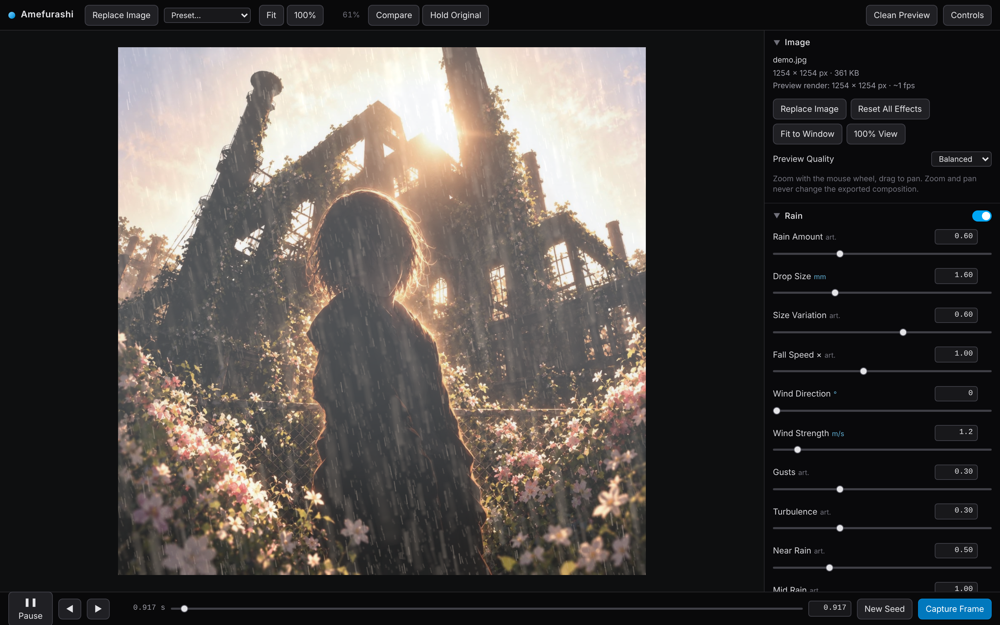

# Amefurashi

*Turn a photograph into a convincing rainy scene.*

Amefurashi adds rain to your own photographs: falling rain in depth, mist, wet surfaces with reflections and ripples, splashes, and rain on glass. Pause at a moment you like and export a high-resolution PNG still, or record a WebM video.
Everything runs locally in your browser with WebGL 2. No account, no upload and no remote API.

**Demo:** https://actofangel.github.io/web-apps/apps/amefurashi/



**Workflow:** open an image → choose a rain preset → refine the atmosphere → pause at a good moment → capture the frame.

## Features

- **Presets**: Soft Drizzle, Overcast Rain, Heavy Shower, Backlit Night Rain, Misty Rain and Rain on Glass.
- **Panels**: Image, Rain, Atmosphere, Glass, Wet Surfaces, Lighting, Camera and Export. Every slider has a numeric input, a tooltip and a reset.
- **Masks**: paint where surfaces are wet and which subjects are protected from rain, with brush size, feathering, overlay preview and undo / redo.
- **Guides**: a ground guide (horizon and tilt) orients ripples, splashes and reflections, and a key light guide places the main light. Guides are never exported.
- **Depth maps**: import a grayscale depth map so rain and mist sit behind objects.
- **Deterministic playback**: every animated layer is a function of time and seed, so a saved time and seed reproduce a frame exactly. Play / pause, a timeline scrubber, frame stepping and new seeds.
- **Preview**: zoom and pan, fit / 100 %, a compare wipe, hold to see the original, and a clean preview mode.
- **Export**:
  - PNG at preview size, original image size or a custom size. The export re-renders at full resolution and is never a screenshot of the editor.
  - WebM video recording at 30 fps (VP9, with VP8 or the browser default as fallback).
- **Projects**: save and load settings, seed, time, masks and depth guide as JSON, optionally with the source image embedded.
- A built-in demo image.

### Keyboard

| Key | Action |
| --- | --- |
| `Space` | Play / pause |
| `,` / `.` | Step one frame back / forward |
| `F` / `1` | Fit / 100 % view |
| `Tab` / `Esc` | Clean preview / exit |
| `N` | New seed |
| `B` (hold) | Show the original |
| `[` / `]` | Brush size |
| `X` | Swap paint and erase |
| `Ctrl`/`Cmd` + `Z`, `Shift` + `Z` | Undo / redo while painting |

## What is physical and what is artistic

Streak length and opacity follow the camera exposure, and drop terminal velocity follows drop size, based on Garg & Nayar's work on rendering rain streaks and on the Marshall–Palmer drop size distribution. Depth of field, mist without a depth map, screen-space reflections, glass droplets and the overcast tone treatment are artistic approximations. See [`source/README.original.md`](source/README.original.md) for the full rendering pipeline, the research notes and the limitations.

## Usage

Open `index.html` in a browser with WebGL 2. No server is needed; the app code, styles and demo image are bundled into this one file.

Video recording needs `MediaRecorder` support. Current Chrome, Edge and Firefox are recommended, and support in Safari varies. If the editor is blank or reports a graphics error, turn on hardware acceleration in the browser.

Amefurashi was formerly called Rain Atelier, and projects saved by Rain Atelier still load.

## Source

The TypeScript / React / Three.js project is in [`source/`](source/). To rebuild:

```bash
cd source
npm install
npm run build
```

The build writes a single self-contained file to `source/dist/index.html`. Copy it here to replace `index.html`.

An end-to-end test that runs in headless Chromium is in `source/scripts/e2e-test.mjs`.

## Credits

The demo image embedded in `index.html` and stored at `source/src/assets/demo.jpg` (and shown in `screenshot.png`) is © 2026 actofangel. All rights reserved.
It is **not** covered by the MIT License and may not be reused, modified or redistributed without permission.
