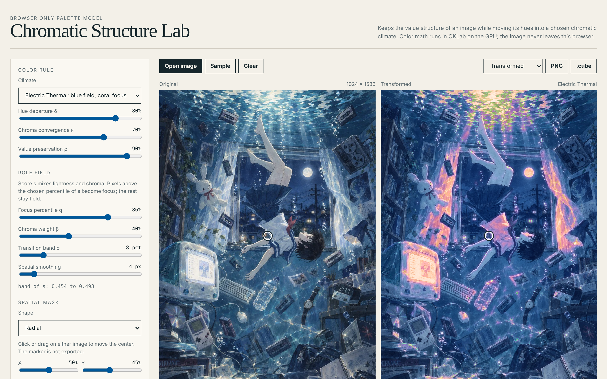

# Chromatic Structure Lab

A palette model that keeps the value structure of an image while moving its hues into a chosen chromatic climate.
All color math runs in OKLab on the GPU (WebGL). The image never leaves your browser.

**Demo:** https://actofangel.github.io/web-apps/apps/chromatic-structure-lab/



## How it works

Each pixel is assigned a **role**, either *field* or *focus*. A score `s` mixes lightness and chroma, and pixels above a chosen percentile of `s` become focus. The climate then gives each role its own target hue, and every pixel is moved toward the target for its role:

```
L′ = ρL + (1−ρ)·Lᵣ(L)
h′ = h ⊕ δ(Hᵣ(L) ⊖ h)
C′ = C + δκ(Cᵣ − C)
```

## Features

- **Climates**: Electric Thermal, Mineral Triad, Teal Ember, Violet Sulfur, and Inverse Climate (rotates every hue 180°). A climate can also be **derived from the image** itself.
- **Color rule**: hue departure δ, chroma convergence κ, and value preservation ρ.
- **Role field**: focus percentile q, chroma weight β, transition band σ, and spatial smoothing.
- **Spatial mask**: uniform (whole image), radial, or elliptical, with center, radius, stretch, rotation and falloff. Click or drag on either image to move the center.
- **Diagnostics**:
  - source clusters (k-means in OKLab, ordered by lightness, width = area), each shown passed through the color rule
  - value fidelity (Pearson r of OKLab L, source vs output)
  - focus area
  - field-to-focus hue gap
- **Right panel views**: transformed image, role field, or spatial mask.
- **Parameter presets**: save, import, export and delete slider settings.
- **Export** the result as PNG, or as a `.cube` 3D LUT for use in other tools.
- A built-in sample illustration.

## Usage

Open `index.html` in a browser. No build step is needed. Use "Open image", drop an image onto the page, or press "Sample".

## Technical notes

A single self-contained HTML file with no external dependencies. Requires a browser with WebGL.

## Credits

The sample illustration embedded in `index.html` (and shown in `screenshot.png`) is © 2026 actofangel. All rights reserved.
It is **not** covered by the MIT License and may not be reused, modified or redistributed without permission.
