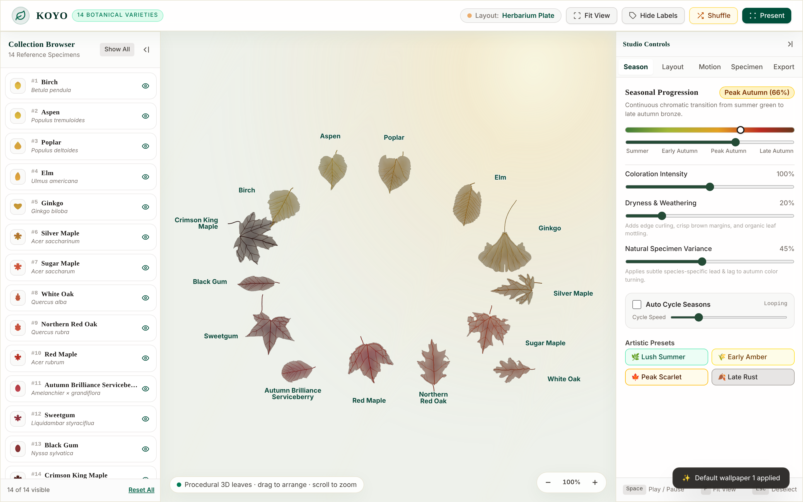

# KOYO

*A botanical studio of 14 autumn leaves, rendered as procedural 3D.*

KOYO is a collection of 14 tree leaves, from Birch and Ginkgo to Sugar Maple and Sweetgum, built as procedural 3D leaves in Three.js. Follow their color from summer green to late autumn bronze, arrange them into compositions, and let them fall over your own photograph in a drifting scene of leaves or flower petals.
Everything runs locally in your browser. Photos you load are never uploaded.

**Demo:** https://actofangel.github.io/web-apps/apps/koyo/

## The collection

Birch (*Betula pendula*), Aspen (*Populus tremuloides*), Poplar (*Populus deltoides*), Elm (*Ulmus americana*), Ginkgo (*Ginkgo biloba*), Silver Maple (*Acer saccharinum*), Sugar Maple (*Acer saccharum*), White Oak (*Quercus alba*), Northern Red Oak (*Quercus rubra*), Red Maple (*Acer rubrum*), Autumn Brilliance Serviceberry (*Amelanchier × grandiflora*), Sweetgum (*Liquidambar styraciflua*), Black Gum (*Nyssa sylvatica*) and Crimson King Maple (*Acer platanoides*).

Each leaf has its own outline, margin, petiole and vein structure, a curved blade surface, and leaf tissue details such as green along the veins, fine veinlets, mottling, spots, insect holes and browned margins.

## Features

- **Season**: seasonal progression from summer to late autumn, coloration intensity, dryness and weathering, natural specimen variance, automatic season cycling, and the presets Lush Summer, Early Amber, Peak Scarlet and Late Rust.
- **Layout**: Circular Wreath (natural tangent, radial out or radial in), Herbarium Plate, Specimen Grid, Comparison Row, Botanical Spiral (Fibonacci phyllotaxis), Harmonic Wave, Botanical Heart, Forest Scatter and Free Atelier. Drag to arrange, scroll to zoom.
- **Motion**: falling leaves or flower petals over a photo backdrop.
  - Choose any of the 14 varieties, or the regional presets Japan · Ginkgo and Paris · Maple + Ginkgo.
  - Petals come in cherry, rose, camellia and cosmos shapes, in five colors.
  - Wind direction, wind strength and gusts, fall speed, 3D flutter and flip, and density.
  - Autumn sunlight with a movable light source, leaf translucency and backlit glow.
  - Virtual perspective with one or two vanishing points placed on the photo.
  - A motion-only view that hides the controls during playback.
- **Specimen**: per-leaf rotation, scale, color, season stage and dryness overrides.
- **Export**:
  - A high-resolution PNG (up to 2800 × 1800 px) or an SVG composition, with or without labels and parchment background.
  - A PNG screenshot of the falling scene, or a WebM video recording at 30 fps.
  - Save and restore the whole workspace as JSON.
- Two built-in default wallpapers for the photo backdrop.

Keyboard: `Space` play / pause, `F` fit view, `Esc` deselect or leave the motion-only view.

## Usage

Open `index.html` in a browser with WebGL. No build step or internet connection is needed.

## Technical notes

A single self-contained HTML file. [Three.js](https://threejs.org/) 0.185.0 (bundled into one ES module) and the [Tailwind CSS](https://tailwindcss.com/) 4.3.4 browser build are embedded in the page, both under the MIT License. Three.js is loaded from the embedded copy through a Blob URL, so the app also works when opened from `file://`.

## Data and sources

Leaf shapes are generated from hand-tuned morphology recipes, checked against the [Natural History Museum plant-traits dataset](https://github.com/NaturalHistoryMuseum/plant-traits) (CC BY 4.0). Outlines, veins and peak autumn colors for each species are traced from reference leaf images. See [`DATA_SOURCES.md`](DATA_SOURCES.md) for the data survey, the processing steps, the known limitations and the full list of sources.

## Credits

The two default wallpapers, `default-wallpaper.jpg` and `default-wallpaper-2.jpg` (also embedded in `index.html` and shown in `screenshot.png`), are © 2026 actofangel. All rights reserved.
They are **not** covered by the MIT License and may not be reused, modified or redistributed without permission.

Leaf morphology data: Natural History Museum, plant-traits dataset, CC BY 4.0. Modification: adjusted the Sugar Maple margin parameters to match the description of an undulate, entire margin.
