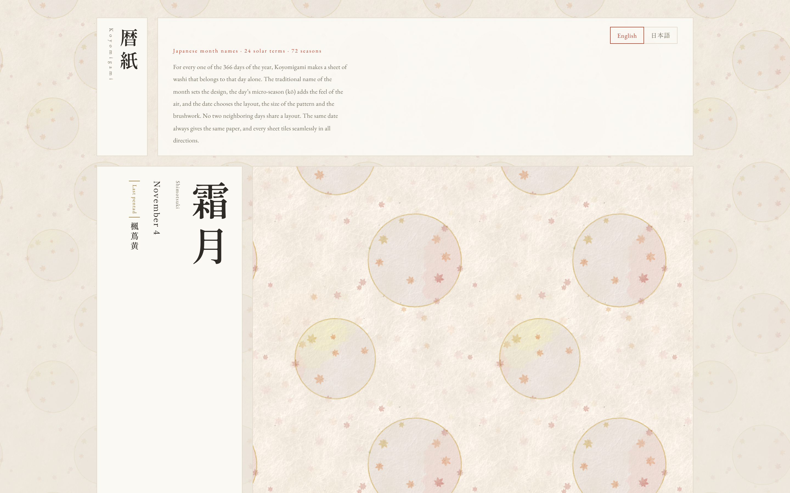

# Koyomigami 暦紙

*Calendar paper: a sheet of washi for every day of the year.*

For every one of the 366 days of the year, Koyomigami forms a sheet of Japanese handmade paper (washi) that belongs to that day alone. The traditional name of the month sets the design, the day's micro-season (*kō*) adds the feel of the air, and the date chooses the layout, the pattern size and the brushwork. No two neighboring days share a layout. The same date always gives the same paper, and every sheet tiles seamlessly in all directions.

**Demo:** https://actofangel.github.io/web-apps/apps/koyomigami/

## The calendar

- **Japanese month names** (*wafū getsumei*): Mutsuki to Shiwasu, each with its origin, other names, colors and design motif.
- **24 solar terms** (*nijūshi sekki*): the sun's yearly course in 24 parts, from Shōkan (Minor Cold) to Tōji (Winter Solstice).
- **72 seasons** (*shichijūni kō*): each solar term split into three pentads of about five days, such as *Kusaretaru kusa hotaru to naru*, "rotten grass becomes fireflies".
- **Seasonal festivals and calendar days**, such as Tanabata and Chōyō. On these days the paper is scattered with gold leaf flakes.

Japanese names are kept as part of the design and shown with romaji and English.

## How the paper is made

1. **Forming the sheet**: a physical model of *nagashizuki* papermaking. Kozo, mitsumata and gampi fibers are laid one by one with their own length, width, curl, kinks and twist, and stacked in layers. The cloudy formation, the laid and chain lines of the screen and the bark specks all come from this process. Color comes from a Kubelka–Munk model of light passing through the fiber layers.
2. **Laying out**: each day picks one of eleven traditional layouts (scattered cards, fans, cloud windows, round windows, snow rings, mist, bands, checkerboard, torn-paper joins, flowing water and more) and a large, medium or small pattern.
3. **Adding touches**: a faint mark tied to the day's season, such as fine rain, frost or firefly lights. The pigment settles where fibers are dense and bleeds slightly along the fiber direction.

## Features

- Date picker with solar-term and festival markers, previous / next day and today. The arrow keys also move between days.
- Paper controls: fiber (kozo, kozo and mitsumata, mitsumata, gampi, kozo with bark specks), basis weight, bark specks, and a transmitted-light view ("hold to the light").
- Pattern size and a seam guide.
- Export a seamless tile (1024 or 2048 px), a phone wallpaper or a desktop wallpaper. Wallpapers can carry a vertical Japanese inscription with the month name, season, date and a solar term seal.
- English and Japanese UI. English is the default, and the choice is remembered.

## Usage

Open `index.html` in a browser. No build step is needed. The paper is computed in a Web Worker.

## Technical notes

A single self-contained HTML file. The washi model (`core`, `stock`, `sheet` and `optics`) is embedded in the page. The only external dependency is Google Fonts.

Dates of the solar terms and seasons follow typical recent years and can shift by about a day from year to year.
