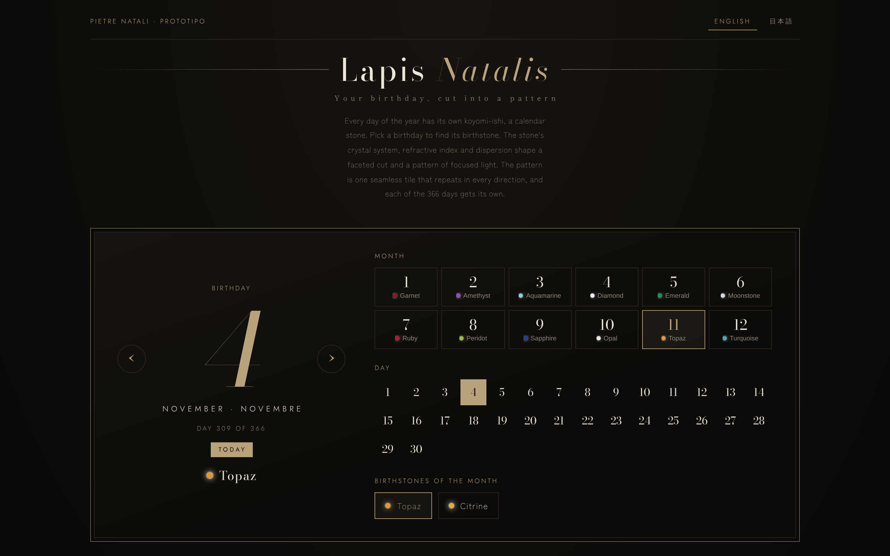

# Lapis Natalis

*Your birthday, cut into a pattern.*

Every day of the year has its own calendar stone. Pick a birthday to find its birthstone. The stone's crystal system, refractive index and dispersion shape a faceted cut and a pattern of focused light (a caustic). The pattern is one seamless tile that repeats in every direction, and each of the 366 days gets its own.

**Demo:** https://actofangel.github.io/web-apps/apps/lapis-natalis/

## How it works

1. **Birthday to stone**: the month picks the birthstone. Month, day and stone name form a seed with 366 outcomes, so the same date always gives the same pattern.
2. **Properties to form**: the refractive index gives the critical angle, which sets the crown and pavilion angles to favor total internal reflection. Opaque stones and opal become cabochons, and pearl becomes a sphere.
3. **Crystal system to symmetry**: cubic maps to the wallpaper group p4m, hexagonal to p6m, trigonal to p3m1, orthorhombic to pmm, monoclinic to p2 and triclinic to p1.
4. **Refraction to pattern**: light passes through a surface built from symmetric waves and lands on the floor below. Stones with higher dispersion split red from blue and leave rainbow edges. Only whole-number wave counts are used, so the tile edges always meet.

## Features

- A month and day picker, with each month's birthstones to choose from.
- A 3D view of the cut stone. Drag it or use the arrow keys to rotate it, and the pattern follows the angle (or hold the pattern in place).
- Stone data: crystal system, refractive index, dispersion, critical, crown and pavilion angles, wallpaper group and date seed.
- The meaning, name origin, nature and legend of each stone.
- Ground (ink or paper), light strength, tiles across, and a tile-seam guide.
- Export a seamless tile or a wallpaper, with optional text (date, the stone's words, or both).
- English and Japanese UI. English is the default, and the choice is remembered.

## Usage

Open `index.html` in a browser. No build step is needed.

## Technical notes

A single self-contained HTML file. The only external dependency is Google Fonts.
