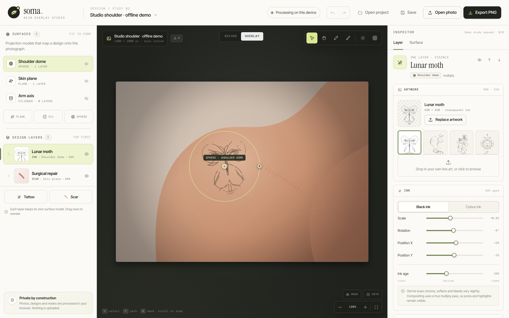

# Soma — Skin Overlay Studio

A studio for previewing tattoos and scars, such as surgical scars, on your own photograph.
All processing of photos, designs and masks happens in your browser. Nothing is uploaded.

**Demo:** https://actofangel.github.io/web-apps/apps/soma-skin-overlay-studio/

## Features

- **Surfaces (projection models)**: plane, cylinder and sphere patch models project a design onto curved areas such as a shoulder or an arm.
- **Tattoo layers**: place the bundled line art or your own PNG / SVG. Adjust black or colour ink, scale, rotation, position and ink age (fading over time). Compositing uses a true multiply pass, so pores and highlights stay visible.
- **Scar layers**: draw control points to generate procedural scars, built from a distance field and normals.
- **Mask brush**: paint where each layer is visible.
- **Lighting**: drag to set the key light direction, or estimate it from the photo's brightness.
- **Before / Overlay comparison**, undo / redo, zoom and pan.
- **Save / open projects** as JSON and **export PNG**.
- A built-in offline demo study.

## Usage

Open `index.html` in a browser. No build step is needed. Use "Open photo" to load a JPG, PNG or WebP image.

### Keyboard shortcuts

| Key | Action |
| --- | --- |
| `V` | Select and move handles |
| `H` | Pan the canvas |
| `P` | Draw scar path |
| `B` | Mask brush |
| `⌘Z` / `⇧⌘Z` | Undo / Redo |

## Technical notes

A single self-contained HTML file. The only external dependency is Google Fonts.
