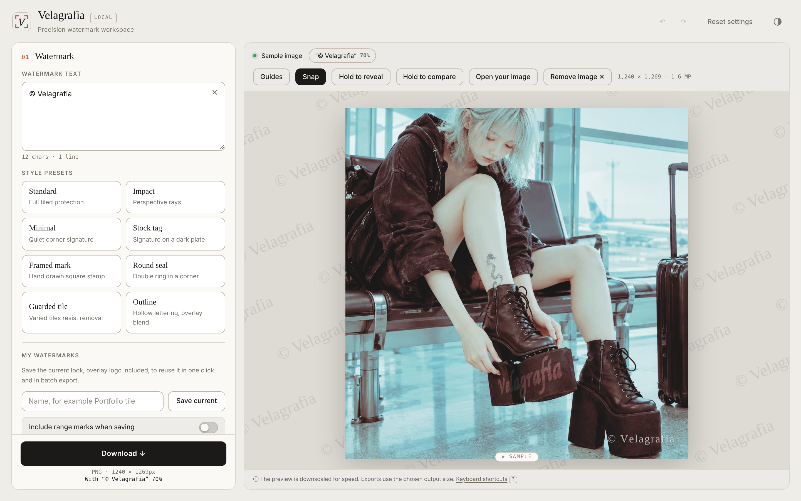

# Velagrafia

A precision watermark workspace. Add text, stamps and logo overlays to your images, embed rights metadata, and export single images or whole batches.
Everything runs locally in your browser. No image is uploaded.

**Demo:** https://actofangel.github.io/web-apps/apps/velagrafia/

## Features

- **Style presets**: Standard (full tiled protection), Impact (perspective rays), Minimal (quiet corner signature), Stock tag (signature on a dark plate), Framed mark (hand-drawn square stamp), Round seal (double ring in a corner), Guarded tile (varied tiles that resist removal), and Outline (hollow lettering with overlay blend).
- **Layouts**: tiled, single, stamp, and vertical text, which stacks the characters top to bottom as on a seal or a hanging sign.
- **Typography**: classic serif, calligraphy, cursive and more, with alignment, bold and letter spacing.
- **Protection**: anti-removal variation, depth (perspective), density and angle controls.
- **Blend modes**: the whole watermark layer is composited at once, as in an image editor. Knockout punches the text out of the image, and PNG / WebP exports keep the holes transparent.
- **Overlay image**: place a logo or a second image above the base.
- **Rights metadata**: embed creator, credit, copyright notice and license URL into the exported file.
- **Snap**: while dragging, items snap to the nine margin positions and the four thirds points.
- **My watermarks**: save the current look, overlay included, and reapply it in one click. Move saved watermarks between devices with a `.velagrafia.json` file.
- **Export**: choose format, output size (up to 6000 px), aspect ratio and crop, or split an image into parts. **Apply to many images** exports a batch as a ZIP.
- **Collage**: arrange several images in a grid of columns with a chosen cell shape.
- Hold to reveal / hold to compare, guides, undo / redo, light and dark themes, and keyboard shortcuts.
- A built-in sample image.

## Usage

Open `index.html` in a browser. No build step is needed. Use "Open your image", or "Try the sample image".

## Technical notes

A single self-contained HTML file with no external dependencies.

## Credits

The sample image embedded in `index.html` (and shown in `screenshot.png`) is © 2026 actofangel. All rights reserved.
It is **not** covered by the MIT License and may not be reused, modified or redistributed without permission.
